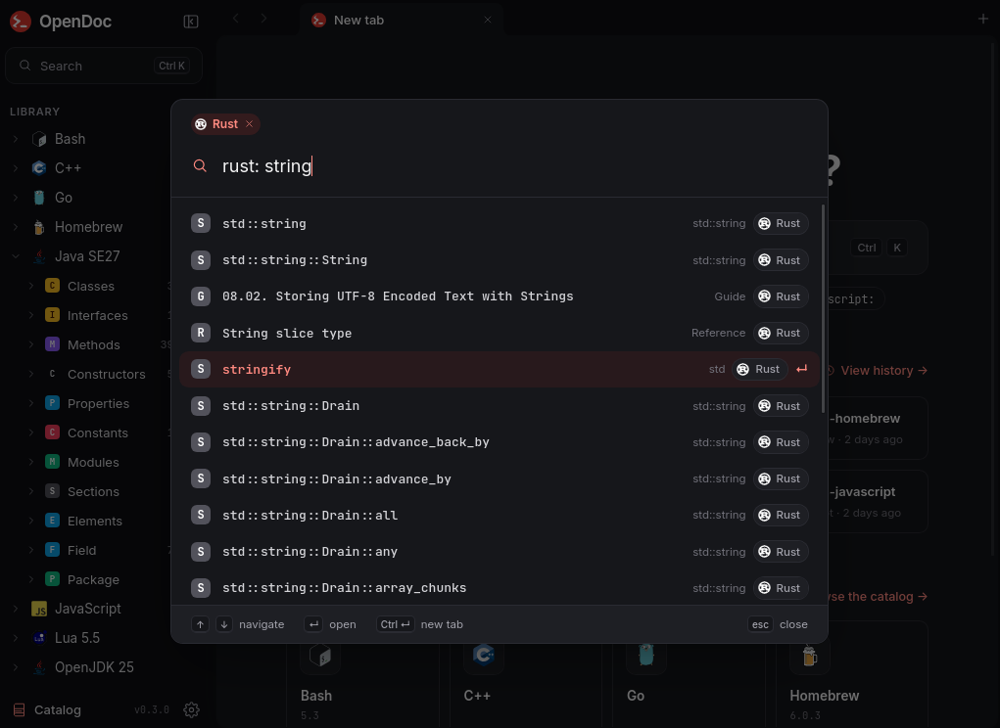

<div align="center">


# OpenDoc

**Toda tu documentación, offline. Encontrada en milisegundos.**

Un lector de documentación rápido y bonito para Windows, macOS y Linux.<br>
844 documentaciones a un clic. Compatible con tus docsets de Dash y Zeal.

[](https://github.com/daidarzzz/opendoc/releases/latest)
[](https://github.com/daidarzzz/opendoc/releases)
[](./LICENSE)


**[⬇ Descargar](https://opendoc.daida.net/download.html)** · **[Web](https://opendoc.daida.net)** · **[English](./README.md)**

</div>

<p align="center"></p>

---

## ¿Por qué OpenDoc?

Pulsa <kbd>Ctrl</kbd> <kbd>K</kbd>, escribe un par de letras y ya estás leyendo la página que buscabas. Sin pestañas del navegador, sin red, sin anuncios, sin cuenta. Solo la documentación que usas cada día, en un avión, en un sótano o con el Wi‑Fi apagado.

- ⚡ **Búsqueda instantánea.** Un motor difuso en Rust mantiene todos los índices en memoria y pone primero lo mejor, en toda tu documentación a la vez.
- 📚 **844 documentaciones incluidas.** El catálogo de [DevDocs](https://devdocs.io/) está listo desde el primer arranque: Python, React, Rust, MDN, Go, Node, Kubernetes… un clic cada una.
- 🗂️ **Pestañas con memoria.** Historial propio por pestaña, arrastrar para reordenar, y tus pestañas, historial y posición vuelven al reabrir la app.
- 🎨 **Hecho para mirarlo.** Temas claro y oscuro, tres estilos visuales, cuatro colores de acento y Liquid Glass nativo en macOS 26 (preview).
- 🔒 **Seguro por diseño.** Cada página se abre en un marco aislado y los enlaces externos van a tu propio navegador.
- 🪶 **Ligero y libre.** Unos pocos megas, código abierto bajo GPL‑3.0.

## Mucho más rápido que Zeal

Tiempo medio por tecla al buscar (menos es mejor):

| Biblioteca | OpenDoc | Zeal | |
| --- | ---: | ---: | :--- |
| 31k entradas · 4 docsets | **1,9 ms** | 10,9 ms | **6× más rápido** |
| 314k entradas · 40 docsets | **5,1 ms** | 69,8 ms | **14× más rápido** |
| 1M entradas · 128 docsets | **13,7 ms** | 219,8 ms | **16× más rápido** |

<sub>La búsqueda de Zeal reconstruida a partir de su código fuente (puntuación fzy dentro de SQLite) y ejecutada junto a `opendoc-core` en la misma máquina: Windows, 12 hilos, mediana de tres ejecuciones, seis consultas escritas letra a letra. Se miden los motores de búsqueda, no las ventanas que los rodean. La contrapartida: OpenDoc carga todos los índices en memoria al arrancar (unos 0,06 s para cuatro docsets).</sub>

## Funcionalidades

<table>
<tr>
<td width="50%" valign="top">

**🔎 Búsqueda**
- Paleta de comandos con resultados en vivo, pensada para el teclado
- Filtra por docset: `py:dumps`, `rust,go:channel`
- Explora todos los símbolos por tipo (clases, funciones, tipos…)
- Buscar en la página con contador de coincidencias

</td>
<td width="50%" valign="top">

**📖 Lectura**
- Pestañas con su propio historial atrás/adelante
- Navegación instantánea: las páginas se precargan al pasar el ratón
- Índice de la página, zoom y desplazamiento suave
- Seguir leyendo e historial de lectura completo
- Modo oscuro para las páginas de los docsets (beta)

</td>
</tr>
<tr>
<td valign="top">

**📦 Biblioteca**
- Catálogo de DevDocs con cola de instalación, actualizaciones y desinstalación
- Usa los docsets que ya tienes de Dash o Zeal
- Más de 170 iconos de lenguajes, todos offline
- Actualizaciones de la app con un clic

</td>
<td valign="top">

**🎨 A tu gusto**
- Estilos Color, Papel y Clásico
- Acentos Rojo, Azul, Ámbar y Catppuccin, incluso en el icono de la app
- Tema claro, oscuro o del sistema
- Inglés y español

</td>
</tr>
</table>

## Instalación

Descarga el instalador para tu sistema desde la **[página de descargas](https://opendoc.daida.net/download.html)** o la [última release](https://github.com/daidarzzz/opendoc/releases/latest):

| Plataforma | Paquetes |
| --- | --- |
| **Windows** | Instalador `.exe`, `.msi` |
| **macOS** | `.dmg` para Apple Silicon e Intel |
| **Linux** | `.AppImage`, `.deb`, `.rpm`, paquete de Arch |

En el primer arranque, abre el **Catálogo** e instala lo que necesites. ¿Ya usas Dash o Zeal? Indica tu carpeta de docsets en **Ajustes → Docsets** y listo.

<details>
<summary><b>Notas y problemas conocidos</b></summary>

- **Binarios sin firmar.** Windows SmartScreen y macOS Gatekeeper muestran un aviso de "editor desconocido" la primera vez que abres OpenDoc.
- **Arch Linux.** Mejor el paquete nativo que la AppImage (usa el WebKitGTK del sistema y va más fluido):
  `sudo pacman -U opendoc-bin-<versión>-1-x86_64.pkg.tar.zst`
- **Renderizado en Linux.** Si la ventana no se abre o no se dibuja, prueba `WEBKIT_DISABLE_DMABUF_RENDERER=1 opendoc`.
- **Actualizaciones.** Las actualizaciones desde la app funcionan con los instaladores de Windows, la app de macOS y la AppImage. Las instalaciones `.deb`, `.rpm` y pacman reciben un enlace a la nueva release.
- **Espacio en disco.** Los docsets empaquetados como *tarix* se extraen a una caché y pueden ocupar decenas o cientos de MB cada uno.

</details>

## Atajos de teclado

| Atajo | Acción |
| --- | --- |
| <kbd>Ctrl/⌘</kbd> <kbd>K</kbd> | Buscar en todo |
| <kbd>Ctrl/⌘</kbd> <kbd>T</kbd> | Nueva pestaña |
| <kbd>Ctrl/⌘</kbd> <kbd>F</kbd> | Buscar en la página |
| <kbd>F3</kbd> | Abrir el catálogo |
| <kbd>Ctrl/⌘</kbd> <kbd>,</kbd> | Ajustes |

## La familia OpenDoc

- **[opendoc-core](https://github.com/daidarzzz/opendoc-core)**: el motor en Rust que escanea, indexa y busca.
- **[opendoc-cli](https://github.com/daidarzzz/opendoc-cli)** (`odc`): la misma búsqueda, directamente desde tu terminal.

## Contribuir

OpenDoc está hecho con **Tauri v2**, **React 19**, **TypeScript** y **Rust**. Para ejecutarlo desde el código:

```bash
git clone https://github.com/daidarzzz/opendoc.git
cd opendoc
npm install
npm run tauri dev
```

Consulta [CONTRIBUTING.md](CONTRIBUTING.md) para requisitos, comprobaciones y builds de release, la [guía de arquitectura](docs/architecture.md) para el mapa del código y [SPEC.md](SPEC.md) para la especificación técnica completa.

## Licencia

Copyright © 2026 daidarzzz. OpenDoc es software libre bajo la [GNU GPL v3.0 o posterior](./LICENSE).

Los docsets pertenecen a sus autores y mantienen sus propias licencias; OpenDoc no los incluye ni los redistribuye.

<details>
<summary>Agradecimientos</summary>

- [DevDocs](https://devdocs.io/), cuyo catálogo es la biblioteca por defecto de OpenDoc.
- [Zeal](https://zealdocs.org/) y [Dash](https://kapeli.com/dash), por el ecosistema de docsets offline. OpenDoc es independiente y no está afiliado a ninguno.
- [nucleo-matcher](https://github.com/helix-editor/nucleo) para la búsqueda difusa.
- [Catppuccin](https://catppuccin.com/) por la paleta Mauve (MIT).
- [Devicon](https://devicon.dev/) por los iconos de lenguajes (MIT, ver `src/assets/devicons/LICENSE`).
- [Bricolage Grotesque](https://github.com/ateliertriay/bricolage), [Inter](https://rsms.me/inter/), [JetBrains Mono](https://www.jetbrains.com/lp/mono/), [Newsreader](https://github.com/productiontype/Newsreader) e [IBM Plex Mono](https://github.com/IBM/plex), incluidas mediante Fontsource (SIL OFL 1.1).

</details>
