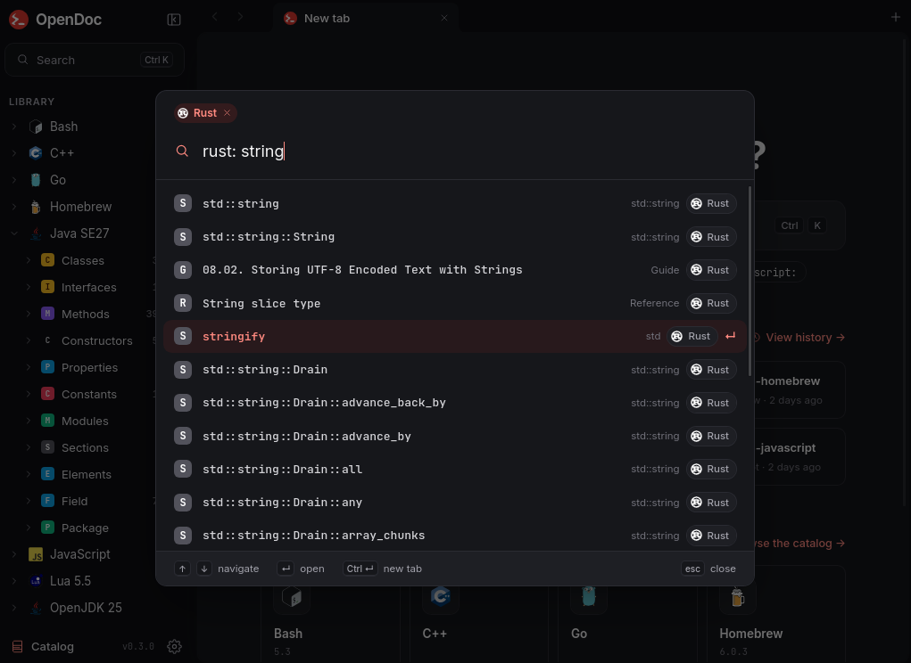

<div align="center">


# OpenDoc

**All your docs, offline. Found in milliseconds.**

A fast, beautiful documentation reader for Windows, macOS and Linux.<br>
844 documentations one click away. Compatible with your Dash and Zeal docsets.

[](https://github.com/daidarzzz/opendoc/releases/latest)
[](https://github.com/daidarzzz/opendoc/releases)
[](./LICENSE)


**[⬇ Download](https://opendoc.daida.net/download.html)** · **[Website](https://opendoc.daida.net)** · **[Español](./README.es.md)**

</div>

<p align="center"></p>

---

## Why OpenDoc?

Press <kbd>Ctrl</kbd> <kbd>K</kbd>, type a few letters, and you're reading the right page. No browser tabs, no network, no ads, no account. Just the docs you use every day, on a plane, in a basement, or with the Wi‑Fi off.

> **Free and open, everywhere.** Dash is great, but it's paid and Mac-only. Zeal brought offline docs to everyone else, but it feels its age. OpenDoc reads the same docsets and aims to be the open source reader that's fast and modern on every platform, **including the Mac**.

- ⚡ **Instant search.** A fuzzy engine in Rust keeps every index in memory and ranks the best match first, across all your docs at once.
- 📚 **844 docs built in.** The [DevDocs](https://devdocs.io/) catalog is ready on first launch: Python, React, Rust, MDN, Go, Node, Kubernetes… one click each.
- 🗂️ **Tabs that remember.** Per-tab history, drag to reorder, and your tabs, history and scroll position come back when you reopen the app.
- 🎨 **Made to be looked at.** Light and dark themes, three visual styles, four accent colors and a native Liquid Glass look on macOS 26 (preview).
- 🔒 **Safe by design.** Every page runs in a sandboxed frame, and external links open in your own browser.
- 🪶 **Small and free.** A few megabytes, open source under GPL‑3.0.

## Faster than Zeal, by a lot

Average time per keystroke while searching (shorter is better):

| Library | OpenDoc | Zeal | |
| --- | ---: | ---: | :--- |
| 31k entries · 4 docsets | **1.9 ms** | 10.9 ms | **6× faster** |
| 314k entries · 40 docsets | **5.1 ms** | 69.8 ms | **14× faster** |
| 1M entries · 128 docsets | **13.7 ms** | 219.8 ms | **16× faster** |

<sub>Zeal's search rebuilt from its source (fzy scoring inside SQLite) and run beside `opendoc-core` on the same machine: Windows, 12 threads, median of three runs, six queries typed letter by letter. It times the search engines, not the windows around them. The trade-off: OpenDoc loads every index into memory at startup (about 0.06 s for four docsets).</sub>

## Features

<table>
<tr>
<td width="50%" valign="top">

**🔎 Search**
- Command palette with live, keyboard-first results
- Filter by docset: `py:dumps`, `rust,go:channel`
- Browse every symbol by kind (classes, functions, types…)
- Find in page with match counter

</td>
<td width="50%" valign="top">

**📖 Reading**
- Tabs with their own back/forward history
- Instant navigation: pages preload on hover
- Page outline, zoom and smooth scrolling
- A light, fully customizable home tab: search, recent pages and favorites (star a page with `Ctrl/⌘ D`), optional library, filters and shortcuts
- Full reading history and favorites panel (`Ctrl/⌘ Y`), also shown in the empty search palette
- Dark mode for docset pages (beta)

</td>
</tr>
<tr>
<td valign="top">

**📦 Library**
- DevDocs catalog with install queue, updates and uninstall
- Use the docsets you already have from Dash or Zeal
- 170+ language icons, all offline
- One-click in-app updates

</td>
<td valign="top">

**🎨 Yours**
- Color, Paper and Classic styles
- Red, Blue, Amber and Catppuccin accents, even on the app icon
- Light, dark or system theme
- English and Spanish

</td>
</tr>
</table>

## Install

Grab the installer for your system from the **[download page](https://opendoc.daida.net/download.html)** or the [latest release](https://github.com/daidarzzz/opendoc/releases/latest):

| Platform | Packages |
| --- | --- |
| **Windows** | `.exe` installer, `.msi` |
| **macOS** | `.dmg` for Apple Silicon and Intel |
| **Linux** | `.AppImage`, `.deb`, `.rpm`, Arch package |

On first launch, open the **Catalog** and install what you need. Already using Dash or Zeal? Point OpenDoc at your docsets folder in **Settings → Docsets** and you're done.

<details>
<summary><b>Notes and known issues</b></summary>

- **Unsigned builds.** Windows SmartScreen and macOS Gatekeeper show an "unknown publisher" warning the first time you open OpenDoc.
- **Arch Linux.** Prefer the native package over the AppImage (it uses your system WebKitGTK and feels faster):
  `sudo pacman -U opendoc-bin-<version>-1-x86_64.pkg.tar.zst`
- **Linux rendering.** If the window doesn't open or render, try `WEBKIT_DISABLE_DMABUF_RENDERER=1 opendoc`.
- **Updates.** In-app updates work with the Windows installers, the macOS app and the AppImage. `.deb`, `.rpm` and pacman installs get a link to the new release instead.
- **Disk usage.** Docsets packaged as *tarix* are extracted to a cache and can take tens or hundreds of MB each.

</details>

## Keyboard shortcuts

| Shortcut | Action |
| --- | --- |
| <kbd>Ctrl/⌘</kbd> <kbd>K</kbd> | Search everything |
| <kbd>Ctrl/⌘</kbd> <kbd>T</kbd> | New tab |
| <kbd>Ctrl/⌘</kbd> <kbd>F</kbd> | Find in page |
| <kbd>F3</kbd> | Open the catalog |
| <kbd>Ctrl/⌘</kbd> <kbd>,</kbd> | Settings |

## The OpenDoc family

- **[opendoc-core](https://github.com/daidarzzz/opendoc-core)**: the Rust engine behind scanning, indexes and search.
- **[opendoc-cli](https://github.com/daidarzzz/opendoc-cli)** (`odc`): the same search, straight from your terminal.

## Contributing

OpenDoc is built with **Tauri v2**, **React 19**, **TypeScript** and **Rust**. To run it from source:

```bash
git clone https://github.com/daidarzzz/opendoc.git
cd opendoc
npm install
npm run tauri dev
```

See [CONTRIBUTING.md](CONTRIBUTING.md) for prerequisites, checks and release builds, the [architecture guide](docs/architecture.md) for the code map, and [SPEC.md](SPEC.md) for the full technical spec.

## License

Copyright © 2026 daidarzzz. OpenDoc is free software under the [GNU GPL v3.0 or later](./LICENSE).

Documentation sets belong to their authors and keep their own licenses; OpenDoc doesn't include or redistribute them.

<details>
<summary>Acknowledgments</summary>

- [DevDocs](https://devdocs.io/), whose catalog powers OpenDoc's default library.
- [Zeal](https://zealdocs.org/) and [Dash](https://kapeli.com/dash), for the offline docset ecosystem. OpenDoc is independent and not affiliated with either.
- [nucleo-matcher](https://github.com/helix-editor/nucleo) for fuzzy matching.
- [Catppuccin](https://catppuccin.com/) for the Mauve palette (MIT).
- [Devicon](https://devicon.dev/) for the language icons (MIT, see `src/assets/devicons/LICENSE`).
- [Bricolage Grotesque](https://github.com/ateliertriay/bricolage), [Inter](https://rsms.me/inter/), [JetBrains Mono](https://www.jetbrains.com/lp/mono/), [Newsreader](https://github.com/productiontype/Newsreader) and [IBM Plex Mono](https://github.com/IBM/plex), bundled via Fontsource (SIL OFL 1.1).

</details>
