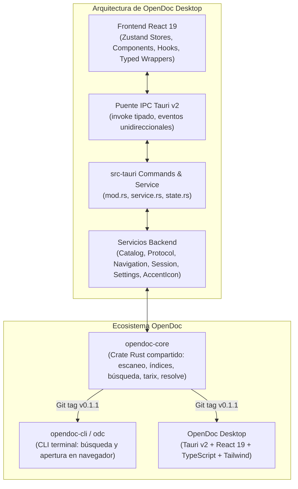

# OpenDoc: Especificación Técnica

Documento de referencia técnica y arquitectura de **OpenDoc** (`v0.2.x`). Define la organización por capas, el flujo de datos, el aislamiento de procesos, el protocolo personalizado y los contratos vigentes entre el frontend y el backend.

---

## 1. Visión y Objetivos

### 1.1 Problema
Los desarrolladores necesitan consultar documentación de referencia sin depender de conexión a Internet. Las alternativas clásicas de escritorio en C++/Qt (como Zeal) presentan interfaces desactualizadas, tiempos de arranque perceptibles, consumo elevado de memoria y escasas opciones de personalización moderna (modos claro/oscuro, paletas dinámicas, navegación fluida por teclado).

### 1.2 Solución
OpenDoc es un visor y buscador de documentación offline rápido y moderno, escrito desde cero (no es un fork) y compatible con el ecosistema de docsets de **Dash y Zeal**.

Pilares de diseño:
1. **Velocidad nativa**: arranque en milisegundos, consumo de RAM contenido (<80 MB en reposo) y búsqueda difusa en memoria interactiva (<50 ms en colecciones de más de 300.000 entradas).
2. **Experiencia de usuario cuidada**: interfaz estilo VS Code / Obsidian con tema oscuro, claro y del sistema, 4 colores de acento dinámicos, navegación por pestañas con persistencia de sesión e historial, y Command Palette (`Ctrl+K` / `Cmd+K`).
3. **Compatibilidad amplia**: soporte para docsets clásicos con índices estándar SQLite (`searchIndex`), esquema Core Data (`ZTOKEN...`), lectura de `Info.plist`, extracción segura de docsets tarix y catálogo integrado configurable.
4. **Seguridad rigurosa**: visualización en `<iframe>` aislado (`sandbox="allow-scripts"`), protocolo propio `opendoc://` con mitigación de path traversal y validación estricta de cualquier evento emitido por contenido externo.

---

## 2. Arquitectura General y Ecosistema

El ecosistema OpenDoc se estructura en tres componentes desacoplados:



### 2.1 Capas y Responsabilidades

| Capa | Tecnologías | Responsabilidad |
|---|---|---|
| **Frontend** | React 19, TypeScript, Tailwind CSS v3, Vite, Zustand | Interfaz gráfica, pestañas, árbol de navegación, Command Palette, atajos globales, i18n, diálogo de ajustes y puente de comunicación con el iframe. |
| **Puente IPC** | Tauri v2 (`core`, `dialog`, `opener`, `os`) | Serialización/deserialización de comandos tipados, emisión de eventos en tiempo real (`docset-progress`, `opendoc-exit-requested`), gestión de ventanas y menú contextual nativo. |
| **Backend de la App** | Rust (`src-tauri/src/`) | Gestión de estado (`AppState`), ciclo de vida, protocolo URI `opendoc://`, persistencia (`settings.json`, `session.json`), catálogo de feeds HTTP (`reqwest::blocking`, `quick-xml`) e iconos dinámicos (`accent_icon`). |
| **Núcleo Compartido** | Rust (`opendoc-core`) | Lógica pura sin red ni Tauri: escáner de docsets, lectura de `Info.plist`, unificación de esquemas SQLite (`searchIndex` / Core Data), índice en memoria (`nucleo-matcher`), extracción tarix y resolución de rutas en disco. |

---

## 3. Módulos del Sistema

### 3.1 Backend (`src-tauri/src/`)

- **`commands/`**:
  - `mod.rs`: define los manejadores `#[tauri::command]` expuestos a Tauri. Valida argumentos y gestiona la concurrencia de instalaciones.
  - `service.rs`: lógica de negocio pura y testeable sin dependencias directas de Tauri runtime.
  - `state.rs`: estructura `AppState` que aloja `Loaded` (docsets cargados, índice `SearchIndex`, historial de incidencias), `settings`, guards de extracción e instalación en curso.
  - `error.rs`: enumerador `ApiError` tipado que mapea fallos de disco, red, formato o lógica hacia el frontend con identificador `kind`.
- **`docset/`**:
  - `install.rs`: cliente de instalación de paquetes `.tgz` desde feeds. Descarga a temporal `.part`, descomprime y valida estructura clásica (`Contents/Resources/`), reemplaza de forma atómica y conserva copias de seguridad `.old` ante fallos.
  - `devicon.rs`: resolución y almacenamiento en caché de iconos de lenguajes procedentes de la CDN oficial de Devicon.
- **`catalog/`**:
  - `feed.rs`: parseo de repositorios de feeds en GitHub y feeds XML compatibles con el formato estándar de Kapeli/Zeal. Normalización de URLs y ordenamiento de mirrors.
  - `mod.rs`: serialización y persistencia atómica de la caché `catalog.json`.
- **`protocol/`**:
  - Manejador del esquema `opendoc://` (en Windows expuesto como `http://opendoc.localhost`).
  - Resolución segura de ficheros dentro de `Documents/`.
  - Inyección en respuestas HTML del estilo forzado claro (`THEME_STYLE`), script de comunicación y atajos (`THEME_SCRIPT`), y normalizador de eventos de rueda/trackpad (`THEME_WHEEL_SCRIPT`).
- **`navigation.rs`**:
  - Función pura `nav_decision` que autoriza URLs internas (`opendoc`, `localhost`, esquemas de Tauri) y reenvía enlaces externos (`http`, `https`, `mailto`) al navegador del sistema a través de `tauri-plugin-opener`.
- **`session/`**:
  - Estructuras `Session`, `SavedTab` y `SavedEntry`. Carga tolerante y guardado atómico en `session.json` con rotación de respaldos `.bak`.
- **`settings/`**:
  - Configuración persistente en `settings.json`: directorio de docsets, tema, acento, idioma, repo de feeds, mirror preferido y preferencia de restauración de pestañas.
- **`accent_icon.rs`**:
  - Embebe mediante `include_bytes!` los PNG generados para los 4 colores de acento y los aplica en caliente a la ventana y al Dock (`NSApplication.setApplicationIconImage` en macOS, `Window::set_icon` en Windows/Linux).
- **`browse.rs`**:
  - Conteo y listado paginado por tipos de símbolos (funciones, clases, constantes, módulos).

### 3.2 Frontend (`src/`)

- **`components/`**:
  - `Viewer.tsx`: contenedor de doble iframe para transiciones suaves sin parpadeo blanco, validación de mensajes postMessage y reenrutamiento de scroll.
  - `Sidebar.tsx`: lista de docsets cargados, árbol de navegación por tipo (`BrowseTree`), acceso al catálogo, enlaces a ajustes y sección de incidencias.
  - `CommandPalette.tsx`: modal flotante de búsqueda rápida con atajos de teclado (`↑`/`↓`, `Enter`, `Esc`), badges por tipo y filtrado por docset.
  - `TabsBar.tsx`: pestañas reordenables por arrastre, botón de nueva pestaña, cierre y estado visual (activo, pendiente tarix o docset ausente).
  - `CatalogView.tsx`: interfaz del gestor de docsets (búsqueda de paquetes, estado de instalación, actualización y progreso de descarga).
  - `Welcome.tsx`: pantalla inicial con accesos directos de búsqueda y selección de carpeta cuando no hay pestañas abiertas.
  - `ErrorDetails.tsx`: desglose de incidencias detectadas durante el escaneo.
- **`store/`**:
  - Stores de Zustand: `docsets`, `tabs`, `palette`, `catalog`, `browse`, `theme`, `accent` y `lang`.
- **`lib/`**:
  - `commands.ts`: funciones envolventes tipadas sobre `invoke()`, `listen()` y diálogos nativos.
  - `types.ts`: tipos TypeScript espejo de los modelos de Rust.
  - `i18n.ts`: diccionarios bilingües inglés/español con claves fuertemente tipadas.
  - `sessionSync.ts`: sincronización reactiva de estado con debounce hacia el backend y vuelco final en cierre.
  - `iframeMessages.ts`: validadores exhaustivos de los mensajes recibidos desde los iframes.
  - `accent.ts`: tokens CSS para los 4 acentos de color con contraste WCAG garantizado.

---

## 4. Flujos Clave del Sistema

### 4.1 Carga de Docsets e Indexación

1. **Configuración inicial**: al arrancar, el frontend ejecuta `set_docsets_dir`. Si no existe carpeta configurada, el backend crea y asigna la carpeta por defecto `<app_data>/docsets`.
2. **Escaneo del sistema de archivos**: `opendoc-core::scanner` inspecciona cada elemento `*.docset`:
   - Lee `Contents/Info.plist` para extraer `CFBundleName`, identificadores, familia de plataforma y `dashIndexFilePath`.
   - Comprueba la existencia de la base de datos SQLite `Contents/Resources/docSet.dsidx`.
   - Identifica el esquema del índice:
     - **Estándar**: tabla `searchIndex(id, name, type, path)`.
     - **Core Data**: tablas `ZTOKEN`, `ZTOKENTYPE`, `ZFILEPATH`, `ZTOKENMETAINFORMATION`.
   - Si no existe `Documents/` pero contiene `tarix.tgz`, se clasifica como `PendingTarix` ("Por instalar"). Si ya existía caché en `tarix-cache/<id>/`, se integra automáticamente.
   - Si el docset está corrupto o incompleto, no detiene la ejecución: se añade una entrada a `ScanReport.issues`.
3. **Construcción del índice en memoria**: las entradas (`Entry`) de todos los docsets válidos se agregan a `SearchIndex`. Los identificadores de docset y tipos de símbolo se almacenan como cadenas compartidas (`Arc<str>`).

### 4.2 Estrategia de Búsqueda y Ranking

- La búsqueda interactiva se ejecuta íntegramente en memoria mediante `nucleo-matcher`, descartando consultas SQL `LIKE` en tiempo de escritura.
- **Jerarquía de puntuación**:
  1. *Coincidencia exacta* del término de búsqueda.
  2. *Coincidencia por prefijo*.
  3. *Coincidencia difusa (fuzzy)* ponderada.
  4. *Coincidencia en el último segmento* de rutas o nombres calificados (p. ej. `dumps` en `json.dumps`).
  5. *Prioridad por tipo de símbolo*: `Class`, `Function`, `Method` y `Struct` tienen prioridad sobre `Guide`, `Section` o `Element`.
- **Filtro de prefijo**: permite restringir la búsqueda a docsets concretos mediante sintaxis `slug:consulta` (p. ej. `py:dumps` o `cpp,rust:vector`). Los prefijos se resuelven contra los docsets cargados.

### 4.3 Entrega de Contenido y Protocolo `opendoc://`

- El contenido de la documentación se sirve a través del protocolo registrado en Tauri:
  - macOS y Linux: `opendoc://<docset_id>/<ruta_relativa>`
  - Windows: `http://opendoc.localhost/<docset_id>/<ruta_relativa>`
- **Seguridad en la resolución**:
  - `opendoc-core::resolve::resolve_request` resuelve la ruta respecto a `Documents/`.
  - Se rechazan terminantemente intentos de navegación hacia directorios superiores (`..`), rutas absolutas, unidades de disco de Windows, symlinks fuera del árbol y secuencias con doble codificación percent.
- **Inyección en documentos HTML**:
  - Se añade un bloque `<style>` para forzar esquema claro en los controles nativos.
  - Se inyecta un `<script>` que:
    - Escucha navegaciones y cambios de ancla (`hashchange`) para notificar al visor principal.
    - Captura el scroll con limitación temporal (debounce a 250 ms) y lo reporta a la ventana principal.
    - Captura y reenvía atajos de teclado esenciales (`Ctrl/Cmd+K`, `Ctrl/Cmd+W`, `Ctrl/Cmd+T`, `Ctrl/Cmd+Tab`, `Alt+←/→`).
    - Captura clics con rueda central o `Ctrl/Cmd+clic` en enlaces internos y solicita apertura en nueva pestaña (`opendoc-open-tab`).
    - Recibe eventos de scroll de trackpad desde el contenedor cuando WebKit los intercepta en el padre.
- **Enlaces externos**:
  - Los clics en enlaces con esquemas `http://` o `https://` fuera del dominio local son interceptados por `navigation::nav_decision` en el manejador `on_navigation` de la ventana y abiertos en el navegador predeterminado del sistema operativo, impidiendo la navegación del visor hacia sitios externos.

### 4.4 Gestión de Pestañas e Historial

- Cada pestaña mantiene su propio historial de navegación independiente (`history: TabEntry[]`, `historyIndex: number`) y un mapa de posiciones de scroll guardadas por URL.
- **Persistencia de sesión**:
  - Se guarda periódicamente (con debounce de 500 ms) en `session.json` dentro del directorio de datos de la app.
  - Estructura: versión de esquema, lista de pestañas guardadas (`SavedTab`) con rutas relativas a `Documents/` sin esquema (para independizarlo de la plataforma), índice activo y scroll.
  - Al cerrar la app, el frontend interrumpe el cierre de la ventana, vuelca la sesión de inmediato con un timeout de seguridad (~1 s) y confirma la salida con `confirm_exit` o `destroyWindow`.
  - Al reabrir, se restauran las pestañas anteriores. Si un docset no está disponible, la pestaña se conserva en estado atenuado sin perder su historial.
  - El ajuste `restore_tabs` permite desactivar por completo la lectura y escritura de sesiones.

### 4.5 Catálogo y Gestor de Docsets

- **Feeds configurables**: el usuario puede especificar un repositorio de GitHub (p. ej. `zealdocs/feeds`) o una URL compatible.
- **Caché sin conexión**: `catalog.json` almacena las entradas tras refrescar el catálogo; la búsqueda y filtrado de feeds funciona completamente offline.
- **Instalación segura**:
  1. Concurrencia limitada: máximo de 2 instalaciones simultáneas en segundo plano.
  2. Descarga del paquete `.tgz` a un archivo `.part` con soporte para selección de mirrors alternativos y registro del mirror más rápido (`fast_mirror`).
  3. Extracción en carpeta temporal `.tmp-install-*` validando que cada archivo pertenezca a la raíz del docset y no exceda límites de tamaño.
  4. Verificación de que el contenido extraído constituye un docset clásico válido con `Contents/Info.plist` e índice SQLite accesible.
  5. Reemplazo atómico: si existía una versión anterior, se mueve temporalmente a `.old`; si la nueva versión es validada con éxito, se borra el `.old`; si ocurre un error, se restaura la versión anterior intacta.
- **Detección de actualizaciones**: comparación estricta de versiones numéricas punteadas (`x.y.z`). Si el feed presenta un esquema de versionado no comparable con seguridad, el indicador permanece en estado neutro (`null`).

---

## 5. Contrato de Comandos Tauri

Todos los comandos se invocan mediante el protocolo IPC de Tauri. La siguiente tabla refleja fielmente las implementaciones reales en `src-tauri/src/commands/mod.rs` y los tipos de `src/lib/types.ts`:

| Comando | Argumentos | Retorno | Descripción |
|---|---|---|---|
| `list_docsets` | *(ninguno)* | `Vec<Docset>` | Lista de docsets cargados en memoria. |
| `set_docsets_dir` | `path: String` | `Result<ScanReport, ApiError>` | Escanea e indexa la carpeta indicada; guarda en ajustes. |
| `search` | `request: SearchRequest` | `Result<SearchResponse, ApiError>` | Búsqueda difusa interactiva con eco de `request_id`. |
| `list_kinds` | `docset_id: String` | `Result<Vec<KindInfo>, ApiError>` | Tipos de símbolo y conteos disponibles en un docset. |
| `list_entries` | `docset_id: String, kind: String, offset?: usize, limit?: usize` | `Result<Vec<NavEntry>, ApiError>` | Lista paginada de símbolos de un tipo específico. |
| `get_docset_home` | `docset_id: String` | `Result<String, ApiError>` | Obtiene la URL canónica `opendoc://` de inicio del docset. |
| `get_settings` | *(ninguno)* | `Settings` | Lee los ajustes persistentes actuales. |
| `set_theme` | `theme: ThemeMode` | `Result<Settings, ApiError>` | Cambia el modo de tema (`light`, `dark`, `system`). |
| `set_accent` | `accent: Accent` | `Result<Settings, ApiError>` | Cambia el acento (`red`, `blue`, `amber`, `catppuccin`) y actualiza el icono. |
| `set_language` | `language: Language` | `Result<Settings, ApiError>` | Cambia el idioma de la interfaz (`en`, `es`). |
| `set_restore_tabs` | `restore: bool` | `Result<Settings, ApiError>` | Habilita o deshabilita la persistencia de pestañas entre sesiones. |
| `get_session` | *(ninguno)* | `Session` | Obtiene la sesión de pestañas guardada (nunca falla). |
| `save_session` | `session: Session` | `Result<bool, ApiError>` | Guarda la sesión si ha cambiado; devuelve si hubo escritura en disco. |
| `extract_tarix` | `docset_id: String` | `Result<ScanReport, ApiError>` | Extrae un docset tarix pendiente a `tarix-cache/`. |
| `get_catalog_status` | *(ninguno)* | `Result<CatalogStatus, ApiError>` | Consulta el estado local del catálogo (offline). |
| `set_feed_repo` | `repo: String` | `Result<Settings, ApiError>` | Configura y valida el repositorio de feeds en ajustes. |
| `refresh_catalog` | *(ninguno)* | `Result<CatalogSummary, ApiError>` | Descarga y parsea la lista de feeds del repositorio configurado. |
| `list_catalog` | `query?: String` | `Result<Vec<FeedEntry>, ApiError>` | Consulta las entradas en la caché local del catálogo. |
| `install_docset` | `feed_id: String, force?: bool` | `Result<InstallSummary, ApiError>` | Descarga e instala un docset emitiendo eventos `docset-progress`. |
| `get_install_status` | `feed_id?: String` | `Result<Vec<InstallStatus>, ApiError>` | Compara feeds contra docsets instalados para detectar actualizaciones. |
| `uninstall_docset` | `feed_id: String` | `Result<String, ApiError>` | Desinstala de forma segura la carpeta `.docset` correspondiente al feed. |
| `confirm_exit` | *(ninguno)* | `()` | Confirma el cierre del proceso tras completar el volcado de sesión. |

### 5.1 Eventos Tauri

- **`docset-progress`**: emitido durante la instalación de docsets. Payload:
  ```json
  {
    "feed_id": "CSS",
    "docset_id": "css",
    "stage": "downloading" | "extracting" | "verifying" | "done" | "error",
    "received_bytes": 1048576,
    "total_bytes": 5242880,
    "files": 120,
    "message": null
  }
  ```
- **`opendoc-exit-requested`**: emitido por el backend cuando el sistema operativo solicita el cierre de la app (p. ej. `Cmd+Q` en macOS) para que el frontend ejecute el guardado final antes de salir.

---

## 6. Aseguramiento de Calidad y CI/CD

El repositorio implementa una batería integral de pruebas en frontend y backend:

1. **Rust**:
   - `cargo test --manifest-path src-tauri/Cargo.toml` (83 tests unitarios y de integración).
   - `cargo clippy --manifest-path src-tauri/Cargo.toml --all-targets -- -D warnings` (cero advertencias permitidas).
   - `cargo fmt --manifest-path src-tauri/Cargo.toml -- --check` (formato estricto según `rustfmt`).
2. **Frontend**:
   - `npm test` (105 tests ejecutados con Vitest: pruebas de historial, validación de mensajes postMessage, i18n, contraste de acentos, stores y serialización de sesión).
   - `npx tsc --noEmit` (comprobación estricta de tipos de TypeScript).
3. **Flujo de Integración Continua (`.github/workflows/release.yml`)**:
   - El trabajo `check` corre en cada push y pull request hacia `master`, validando `npm ci`, `cargo test`, `cargo clippy`, `cargo fmt`, `npx tsc --noEmit` y `npm test`.
   - El trabajo `verify-version` comprueba la coherencia exacta entre la versión de `package.json`, `src-tauri/Cargo.toml` y `src-tauri/tauri.conf.json`.
   - La compilación de artefactos para Windows (.exe, .msi), macOS (.dmg ARM64 e Intel) y Linux (.deb, .AppImage, .rpm) se ejecuta automáticamente ante tags de versión (`v*`).

---

## 7. Decisiones Técnicas y Limitaciones Conocidas

### 7.1 Decisiones Técnicas Consolidadas
- **Modo oscuro en docsets desactivado**: el tema oscuro de la aplicación aplica exclusivamente a la interfaz nativa (chrome, barra lateral, pestañas, modales). Los documentos HTML de los docsets se muestran con su presentación clara original. La inversión mediante filtros CSS globales producía artefactos visuales inaceptables en diagramas, tablas y bloques de código; el mecanismo de inyección permanece reservado para soporte de temas CSS específicos por docset en versiones posteriores.
- **Iconos de acento en tiempo de ejecución**: el acento de color afecta al logo y a los elementos interactivos de la interfaz, así como al icono de la app en ejecución en la barra de tareas y el Dock. El icono empaquetado en el ejecutable, instalador y Finder permanece en el rojo de marca para mantener la identidad visual del archivo.
- **Independencia de Kapeli**: OpenDoc no depende de servicios propietarios ni redistribuye documentación ajena; los feeds se consultan desde repositorios comunitarios abiertos.
- **Límite de concurrencia en instalaciones**: máximo 2 instalaciones simultáneas para proteger el ancho de banda y evitar contención en disco.

### 7.2 Limitaciones Conocidas
- **Firma de código**: los instaladores distribuidos en GitHub Releases no cuentan con certificados comerciales de firma de código; Windows SmartScreen y macOS Gatekeeper mostrarán advertencias estándar durante la primera instalación.
- **WebKitGTK en Linux**: el comportamiento del renderizado de WebKit en distribuciones Linux puede diferir ligeramente respecto a WebView2 (Windows) y WebKit (macOS).
- **Extracción de paquetes tarix pesados**: docsets voluminosos pueden requerir varios cientos de megabytes de espacio en la caché de la aplicación una vez extraídos.
- **Cancelación de extracciones**: una vez iniciada la extracción de un docset o paquete tarix, la operación se ejecuta hasta su conclusión o fallo (no existe botón interactivo de cancelación a mitad de proceso). Un fallo nunca corrompe la caché anterior.

### 7.3 Funcionalidades Futuras (Hoja de Ruta)
- Marcadores de favoritos y elementos recientes.
- Índice de contenido (TOC) contextual de la página visualizada.
- Temas visuales personalizados inyectados por lenguaje o familia de docset.
- Instancia única garantizada a nivel de sistema operativo (single-instance plugin).
